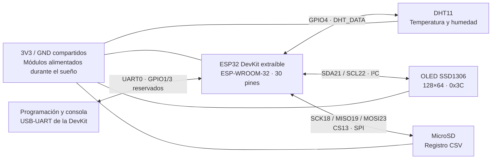

# Diagrama lógico de bloques — revisión A

Fecha: 2026-11-02. Conjunto validado en protoboard. Este dibujo representa relaciones funcionales; no es un esquemático eléctrico ni determina un layout.

Las flechas dobles agrupan cada interfaz; las direcciones de sus señales individuales están en la [tabla de conexiones](conexiones-rev-a.md). El dibujo no define números de contacto, componentes pasivos ni conmutación de alimentación.

## Comportamiento validado

Cuatro intentos separados por cinco segundos nominales; presentación OLED y registro CSV cuando hay SD; cierre de almacenamiento y sueño configurado de sesenta segundos. El usuario confirmó cinco ciclos normales y continuidad/recuperación frente a ausencia de componentes. Consumo y precisión independiente del reloj no se han medido.

## Cómo crecerá este dibujo

Tras cada práctica se añadirá el componente validado, su interfaz y sus conexiones adoptadas, revisando conflictos con los bloques anteriores. Los módulos pendientes del plan no se presentan como circuitos ya probados ni reciben asignaciones definitivas aquí.

El diseño de esquemático/PCB y EasyEDA quedan para después de verificar todos los sensores/componentes previstos y se desarrollarán en un chat exclusivo. En este chat continuamos firmware, validación en protoboard, tabla y diagrama lógico.
